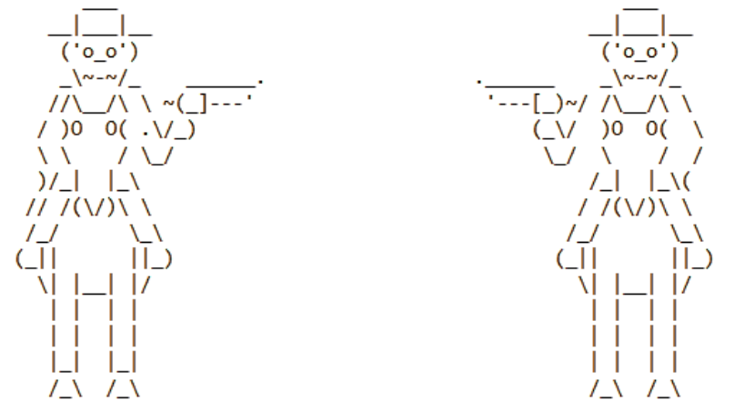
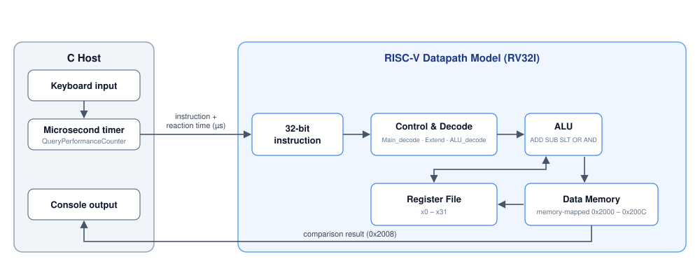

# RISC-V Reaction Game


[**View Source Code**](risc-v.c) · [Lab Report](docs/Lab_report.docx) · [Architecture](#architecture) · [Build & Run](#build--run)

> A two-player "Cow-Boy" shoot-out powered by a **RISC-V (RV32I) datapath model written in C**.
> The C host handles keyboard input and microsecond timing; the simulated processor decodes and executes the
> machine-code instructions that store each player's reaction time and decide the winner.

**Course:** Microprocessors – Peripheral Units, Laboratory Assignment #10
**Program:** B.Sc. Computer Engineering (International), Ilia State University / San Diego State University
**Author:** Jambuli Chkhikvadze

---



## Overview

The goal of the lab was to write RISC-V code for a device specified by the instructor and to integrate a custom-built
RISC-V processor model with real-time peripherals. The result is a reaction game:

1. Players press **SPACE** and wait for the 3-2-1 countdown.
2. On **SHOOT!**, Player 1 presses **A** and Player 2 presses **L** as fast as possible.
3. Each reaction time is stored in memory by the simulated processor.
4. The processor compares the two times with `slt` and writes the result back to memory.
5. The host reads the result and announces the winner (or a draw).

The design cleanly separates **low-level instruction execution** (RISC-V model) from **high-level game logic and I/O** (C host).

## Architecture



| Component | Role |
|-----------|------|
| `Main_decode()` | Main control unit: generates `RegWrite`, `ALUSrc`, `ResultSrc`, `MemWrite`, `Branch`, `Jump`, `ImmSrc`, `ALUOp` |
| `ALU_decode()` | Maps `ALUOp`, `funct3`, `funct7` to the ALU control code |
| `Extend()` | Immediate generator for I, S, B and J formats with sign extension |
| `ALU()` | ADD, SUB, SLT, OR, AND |
| `execute_instruction()` | Decodes and executes one 32-bit instruction through the datapath |
| `Register_File[32]` | RISC-V register file (`x0` hard-wired to zero) |
| `Data_Memory[]` | Word-addressable memory (`index = address >> 2`) |

### Instruction formats

| Format | Instructions | Role in this lab |
|--------|--------------|------------------|
| **R-type** | `add`, `sub`, `slt`, `or`, `and` | `slt` decides the winner |
| **I-type** | `addi`, `lw` | immediate arithmetic and loads |
| **S-type** | `sw` | stores reaction times and the comparison result |
| **B / J-type** | `beq`, `jal` | control-unit decode and immediate generation, carried over from earlier labs |

## Memory Map

Peripheral registers are modelled as memory-mapped locations in `Data_Memory[]`:

| Address | Purpose | `Data_Memory` index |
|---------|---------|---------------------|
| `0x2000` | Player 1 reaction time (µs) | `0x800` |
| `0x2004` | Player 2 reaction time (µs) | `0x801` |
| `0x2008` | Comparison result (`slt`: 1 = Player 1 faster) | `0x802` |
| `0x200C` | Game status (reserved) | `0x803` |

## Processor Program

### 1. Store a reaction time — `risc_v_store_player_time()`

| Step | Operation |
|------|-----------|
| Reaction time into `x5` | `x5 ← reaction_time` |
| Peripheral address into `x6` | `x6 ← 0x2000` (P1) or `0x2004` (P2) |
| Store to the peripheral register | `sw x5, 0(x6)` |

### 2. Determine the winner — `risc_v_compare_and_determine_winner()`

| Step | Operation |
|------|-----------|
| Read Player 1 time | `lw x7, 0x2000(x0)` |
| Read Player 2 time | `lw x8, 0x2004(x0)` |
| Compare | `slt x9, x7, x8` → `x9 = 1` if Player 1 was faster |
| Store result | `sw x9, 0x2008(x0)` |

The host then reads `0x2008`; equal times are reported as a draw.

### Instruction encoding

Instructions are assembled by hand with bit-field operations (opcode, `rd`, `rs1`, `rs2`, `funct3`, `funct7`)
and passed to `execute_instruction()`:

```c
// sw x5, 0(x6)   — S-type
uint32_t sw_instruction =
    (0 << 25)     |   // imm[11:5]
    (5 << 20)     |   // rs2    = x5
    (6 << 15)     |   // rs1    = x6
    (0b010 << 12) |   // funct3 = 010 (word)
    (0 << 7)      |   // imm[4:0]
    0b0100011;        // opcode = STORE

// slt x9, x7, x8 — R-type
uint32_t slt_instruction =
    (0 << 25)     |   // funct7
    (8 << 20)     |   // rs2    = x8
    (7 << 15)     |   // rs1    = x7
    (0b010 << 12) |   // funct3 = 010 (slt)
    (9 << 7)      |   // rd     = x9
    0b0110011;        // opcode = OP
```

## Build & Run
 
The source targets the Windows console API (`<conio.h>`, `<windows.h>`). To build the **same, unmodified source** on Linux and macOS,
the repository includes small compatibility headers in [`compat/`](compat) that provide `_kbhit()`, `_getch()`, `Sleep()` and
`QueryPerformanceCounter()` on top of POSIX (`termios`, `clock_gettime`). Both platforms give microsecond timing.
 
### Linux / macOS
 
```bash
# 1. Install a C compiler (skip if gcc/clang is already installed)
sudo apt install build-essential        # Debian / Ubuntu
sudo dnf install gcc make               # Fedora
sudo pacman -S base-devel               # Arch
xcode-select --install                  # macOS
 
# 2. Build (either command)
make
# or
gcc -O2 -Wall -Icompat risc-v.c -o reaction_game
 
# 3. Run (in a real terminal)
./reaction_game
```
 
### Windows
 
```bash
# MinGW / MSYS2
gcc risc-v.c -o reaction_game.exe
./reaction_game.exe
 
# MSVC (Developer Command Prompt)
cl risc-v.c /Fe:reaction_game.exe
```
 
### Controls

| Key | Action |
|-----|--------|
| `SPACE` | Start a round (3-2-1 countdown) |
| `A` | Player 1 shoots |
| `L` | Player 2 shoots |
| `R` | Reset the game |
| `ESC` | Quit |

### Example output

```
=== GAME RESULTS ===
Player 1 reaction time: 312450 microseconds
Player 2 reaction time: 287310 microseconds
RISC-V ALU comparison result (P1 < P2): 0
 PLAYER 2 WINS! Faster by 25140 microseconds!
```

## Repository Structure

```
.
├── risc-v.c              # C host + RISC-V datapath model
├── docs/
│   ├── Lab_report.docx   # Full lab report
│   └── architecture.svg  # Architecture diagram
├── .gitignore
├── LICENSE
└── README.md
```

## Learning Outcomes

- RISC-V instruction formats and manual machine-code encoding
- Control-unit and ALU-decoder design (single-cycle datapath)
- Memory-mapped peripheral modelling
- Hardware/software partitioning between a host program and a processor model
- Real-time input handling and high-resolution timing in C

## Author

Jambuli Chkhikvadze

## License

Copyright (c) 2026 Jambuli Chkhikvadze. All rights reserved.

This repository is published for viewing and portfolio purposes. No permission is granted to copy, modify,
distribute or use the code or documentation without written consent of the author. See [LICENSE](LICENSE).

## Trademarks

RISC-V is a registered trademark of RISC-V International. This project is an independent educational implementation
of the open RV32I instruction set and is not affiliated with or endorsed by RISC-V International.
Windows is a trademark of Microsoft Corporation.
